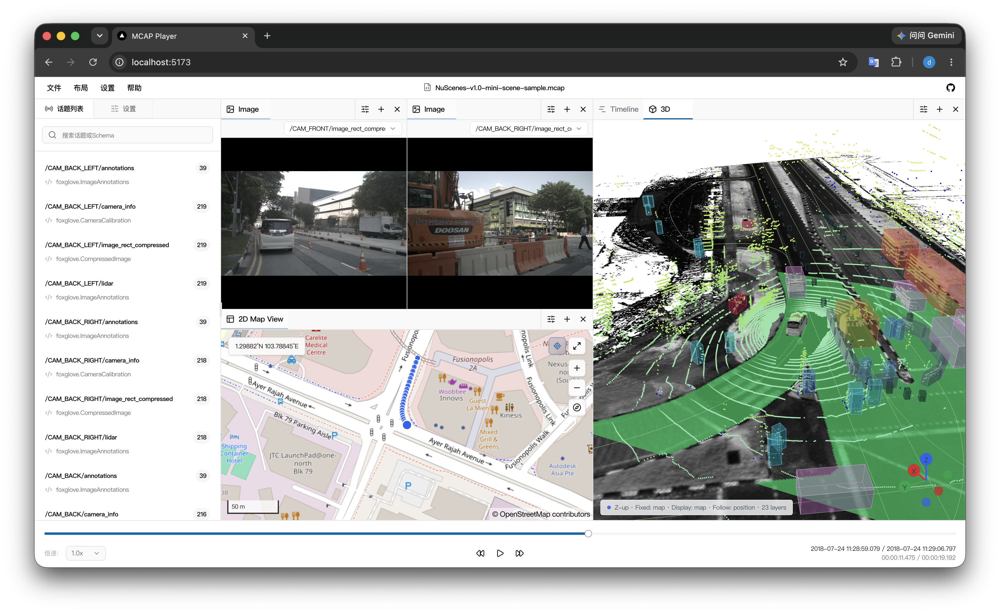

# MCAP Player

English | [简体中文](README.zh-CN.md)

A high-performance, browser-based MCAP player and visualization tool for robotics, autonomous driving, and other time-series sensor data workflows.

[](https://github.com/42arch/mcap-player/actions/workflows/release.yml)


[**Live Demo →**](https://mcap-player.netlify.app/)

MCAP Player opens local files directly or streams remote files on demand using HTTP Range requests. Parsing, decompression, and data processing run inside Web Workers, so no desktop client is required and local files never leave your browser.

[](https://mcap-player.netlify.app/)

## Features

- **Local and remote data sources**: Open local `.mcap` files or stream remote files from HTTP/HTTPS URLs
- **Multiple message formats**: Decode ROS 1, ROS 2, Protobuf, JSON, and JSON Schema messages
- **Built-in visualization panels**: Explore file summaries, raw messages, images, plots, timelines, 2D maps, and 3D scenes
- **Full playback controls**: Play, pause, seek, step backward or forward, and adjust playback speed
- **Large-file performance**: Reduce main-thread and network pressure with Web Workers, block-based reads, in-memory caching, and session caching
- **Flexible workspace**: Group panels, rearrange layouts with drag and drop, and import or export layout configurations
- **Languages and themes**: Switch between Simplified Chinese and English, with light, dark, and system themes
- **MCAP compression support**: Read uncompressed, Zstd-compressed, and LZ4-compressed chunks

## Quick Start

### Prerequisites

- [Bun](https://bun.sh/) 1.4.3, as specified by `packageManager` in `package.json`

### Run Locally

```bash
git clone https://github.com/42arch/mcap-player.git
cd mcap-player
bun install
bun run dev
```

Open the local URL shown in the terminal, usually `http://localhost:5173`.

### Production Build

```bash
bun run build
```

## Usage

1. Choose a local MCAP file, enter a remote file URL, or open the built-in example from the landing page.
2. Browse the file's channels and schemas in the Topic list on the left.
3. Add visualization panels to the workspace and select the relevant Topic for each panel.
4. Use the playback bar at the bottom to control time, playback speed, and seeking.
5. Export the current workspace from the **Layout** menu and import it again when needed.

## License

[MIT](https://opensource.org/license/mit)
