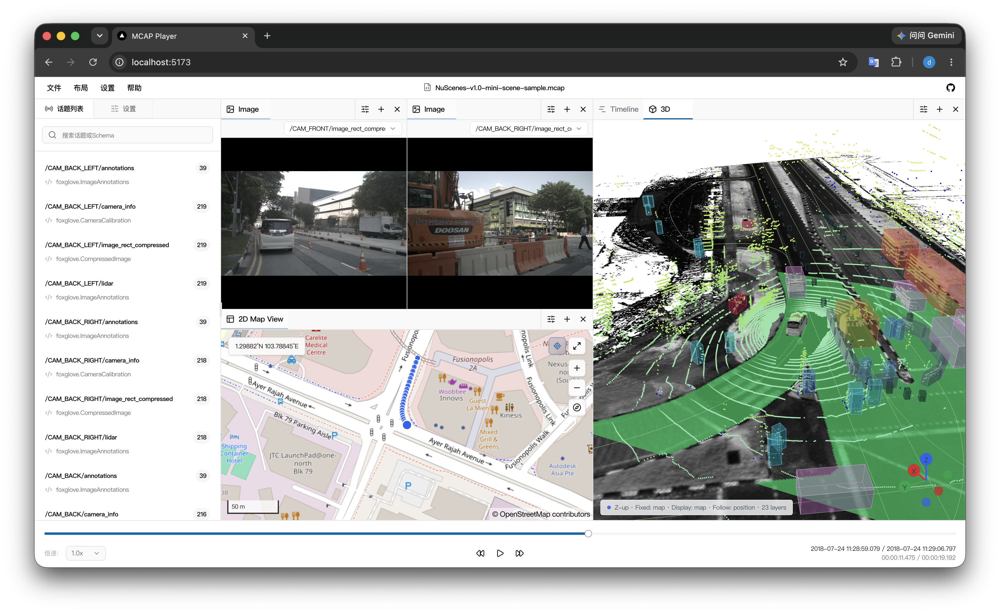

# MCAP Player

[English](README.md) | 简体中文

一个运行在浏览器中的高性能 MCAP 数据播放器与可视化工具，面向机器人、自动驾驶及其他时序传感器数据的分析场景。

[](https://github.com/42arch/mcap-player/actions/workflows/release.yml)


[**在线体验 →**](https://mcap-player.netlify.app/)

MCAP Player 可以直接打开本地文件，也可以通过 HTTP Range 请求按需读取远程文件。解析、解压与数据处理运行在 Web Worker 中，无需安装桌面客户端或上传本地数据。

[](https://mcap-player.netlify.app/)

## 功能特性

- **本地与远程数据源**：打开本地 `.mcap` 文件，或从 HTTP/HTTPS URL 按需读取远程文件
- **多格式消息解析**：支持 ROS 1、ROS 2、Protobuf、JSON 与 JSON Schema 消息
- **常用可视化面板**：提供文件概览、原始消息、图像、曲线、时间轴、2D 地图和 3D 空间视图
- **完整播放控制**：支持播放、暂停、时间跳转、逐秒前后移动与倍速播放
- **大文件友好**：使用 Web Worker、分块读取、内存缓存与会话缓存降低主线程和网络压力
- **灵活工作区**：支持面板分组、拖拽布局以及布局配置的导入和导出
- **双语与主题**：内置简体中文、英文以及浅色、深色和跟随系统主题
- **MCAP 压缩支持**：支持未压缩、Zstd 和 LZ4 数据块

## 快速开始

### 环境要求

- [Bun](https://bun.sh/) 1.4.3（以 `package.json` 的 `packageManager` 为准）

### 本地运行

```bash
git clone https://github.com/42arch/mcap-player.git
cd mcap-player
bun install
bun run dev
```

根据终端提示打开本地地址，通常为 `http://localhost:5173`。

### 生产构建

```bash
bun run build
```

## 使用方法

1. 在首页选择本地 MCAP 文件、输入远程文件地址，或打开内置示例。
2. 从左侧 Topic 列表查看文件中的通道和 Schema。
3. 在工作区添加所需面板，并为面板选择对应 Topic。
4. 使用底部播放栏控制时间、播放速度和跳转位置。
5. 通过“布局”菜单导出当前工作区，之后可再次导入使用。

## License

[MIT](https://opensource.org/license/mit)
