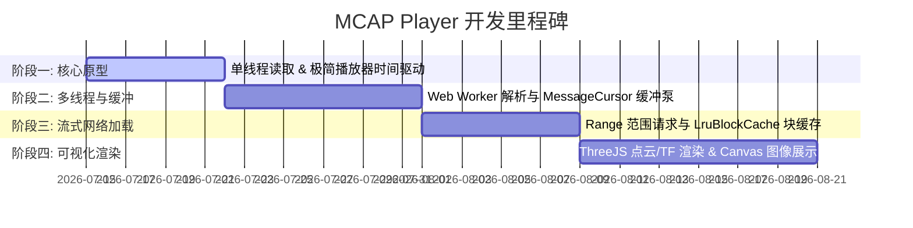

# 基于 React & Next.js 的高性能 MCAP 播放器技术设计方案

本方案为自主研发一个高性能、浏览器原生运行的 MCAP 录制文件播放器（MCAP Player）提供技术方案设计。方案吸取了 Foxglove 和 ROSView 的核心架构优势，并针对 React 19 + Next.js 16 技术栈进行了最佳方案优化，旨在确保百兆至吉字节（GB）级大文件的流畅播放与极速 Seek。

---

## 1. 系统架构方案设计

### 1.1 核心挑战与架构策略

1. **CPU 密集型解压与反序列化**：MCAP 的 Chunk 解密（Zstd/LZ4）与 ROS/Protobuf 消息解析极耗 CPU。
   - **方案**：采用 **双线程隔离架构**。主线程仅做 UI 交互与 Canvas 渲染，所有 IO、解密、反序列化全部移入单独的 Web Worker。
2. **线程间高频传输的性能损耗**：大体积点云与图像的高频结构化克隆（Structured Clone）会阻塞主线程。
   - **方案**：利用 **Transferable Objects（转移所有权）** 机制，秒级转移 ArrayBuffer；对点云或视频流做 **同一帧内高频合并（Coalescing）**，仅保留最新帧，直接丢弃冗余帧。
3. **React 重绘风暴**：高频数据（如 100Hz 的 TF）如果通过 React State 传递，会导致 React Fiber 树疯狂重绘挂起。
   - **方案**：建立 **React 外部的高频事件总线（MessageBus）**。渲染组件通过发布订阅模式直接操作 DOM Canvas/Three.js 场景，绕过 React 的重新渲染。

### 1.2 整体数据流与线程模型

```mermaid
flowchart TB
    subgraph MainThread [主线程 - Main UI & Render Thread]
        ReactUI[React UI 控制与时间轴]
        Clock[PlaybackClock 虚拟线性时钟]
        Controller[PlaybackController 播放状态机]
        Bus[MessageBus 原生事件订阅总线]

        subgraph RenderPanels [画布与渲染组件]
            RawMsgPanel[Raw Message View 原始数据面板]
        end
    end

    subgraph WorkerThread [后台 Worker 线程 - Data Engine]
        Cursor[MessageCursor 游标缓冲队列]
        McapSource[McapIndexedSource 索引与流读取]
        Cache[LruBlockCache HTTP Range 缓存]
        Decompressor[@mcap/support 块级解压器]
    end

    %% 输入与读取
    Input[数据源 - Local/Remote] --> Cache
    Cache --> McapSource

    %% 元数据与控制流
    McapSource --> Controller
    Controller --> Clock
    Controller --> Cursor

    %% 数据解压与消费流
    McapSource --> Decompressor
    Decompressor --> Cursor
    Cursor --> Bus

    %% 订阅渲染流
    Bus --> RawMsgPanel
    Bus --> ReactUI
```

---

## 2. 技术栈选型

| 模块            | 推荐技术                                | 选型理由                                                                                                                                      |
| :-------------- | :-------------------------------------- | :-------------------------------------------------------------------------------------------------------------------------------------------- |
| **构建与编译**  | Next.js 16 + TS 5.x                     | 现代工程构建与 SSR/CSR 框架标配，内置 App Router，对 Web Worker / API Routes / 静态输出等有完善支持。                                         |
| **前端框架**    | React 19 (或 React 18)                  | 利用其并发特性与现代组件生命周期管理 UI 状态。                                                                                                |
| **状态管理**    | `zustand`                               | 轻量级、无模板代码的状态管理库。用于管理低频全局 UI 状态（如播放状态、选中话题、文件元数据等），作为 React 与 PlaybackController 之间的桥梁。 |
| **线程通信**    | `comlink` (Google)                      | 优雅的 RPC 包装，将 Worker 的异步方法映射为 Promise 调用。                                                                                    |
| **数据源解析**  | `@mcap/core` + `@mcap/browser`          | MCAP 官方核心包。`@mcap/browser` 提供浏览器专用的 `BlobReadable`，极简化本地拖拽或上传文件的随机流式读取。                                    |
| **解压处理器**  | `@mcap/support` (集成 LZ4 & WASM Zstd)  | 官方开箱即用的解压包，支持自动探测环境并在运行时加载对应的 LZ4 与 WASM Zstd 解压处理器，免去手动集成的麻烦。                                  |
| **数据展示**    | 纯 React 配合 JSON Inspector / 文本渲染 | 用于 Milestone 4 实现的原始数据（Raw Message）的格式化展示，作为首期调试工具。                                                                |
| **3D 点云渲染** | `three` (暂不实现)                      | 规划用于未来构建高性能 WebGL 机器人、点云与 TF 空间展示环境。                                                                                 |
| **时序图表**    | `uplot` (暂不实现)                      | 规划用于未来做高频时序指标对比图表展示。                                                                                                      |
| **UI 样式**     | Tailwind CSS v4 + Radix UI Primitive    | 精简的原子化 CSS，配合无样式的 UI Primitive 快速构建 Dock 可拖拽布局。                                                                        |

---

## 3. 关键模块详细方案设计

### 3.1 数据加载与网络缓存模块 (IO & Cache)

为了支持极大的远程文件快速点播，我们需要实现**字节级随机读取接口**与**滑动块缓存**：

1. **接口定义与本地读取**：
   对于本地上传或拖入的 `.mcap` 文件，直接使用 `@mcap/browser` 提供的 `BlobReadable`（其内部已实现了符合要求的 `IReadable` 随机读取接口），从而免去手动包装逻辑。
   ```typescript
   export interface IReadable {
     size: () => Promise<bigint>
     read: (offset: bigint, length: bigint) => Promise<Uint8Array>
   }
   ```
2. **`RangeHttpReader`**：封装 `fetch` 并添加 `Range: bytes=start-end` 请求头，专职从远程静态服务器以切片形式拉取二进制流，需手动实现 `IReadable` 接口。
3. **`LruBlockCache`（滑动块缓存）**：
   - 将文件逻辑上划分为以 `32MB` 或 `64MB` 为单位的物理块。
   - 用一个 `Map<number, Uint8Array>` 存储已下载的物理块，采用 **LRU（最近最少使用）** 淘汰算法维持总体积在 512MB 以内。
   - 自动探测正常播放的顺序下载轨迹，一旦命中连续性，自动提前发起下一块的异步拉取（Pre-fetch）。

### 3.2 Worker 游标数据缓冲引擎 (Buffering Engine)

在 Worker 中，通过迭代器拉取数据并建立滑动缓冲池：

1. **`McapIndexedSource`**：
   - 调用 `@mcap/core` 的 `McapIndexedReader`。
   - 在初始化时，调用 `@mcap/support` 的 `loadDecompressHandlers()` 异步加载解压处理器，并传入 `McapIndexedReader.Initialize`，以自动支持 Zstd 与 LZ4 压缩块。
   - 仅读取元数据索引，快速返回整个包的 `TopicInfo`、`Datatypes`（Schema）和包的精确起止时间 `start` 与 `end`。
2. **`MessageCursor` (游标缓冲控制器)**：
   - 包含一个后台异步自执行循环 `_pump()`。
   - 只要队列中消息数少于 500 条且数据总量少于 20MB，它就源源不断地从数据源读取、解压并反序列化消息。
   - 一旦缓存填满，利用 `await promise` 挂起自身，进入静默状态，直到主线程消费后由 `resolve` 唤醒。

### 3.3 时钟与播放状态机 (Clock & Player State Machine)

主线程负责精准的“时间管理”：

1. **`PlaybackClock`（高精时钟）**：
   记录锚点墙上时间 $t_{\text{wall}}$、数据包内锚点时间 $T_{\text{bag}}$ 和播放速率 $S$：
   $$T_{\text{now}} = T_{\text{bag}} + (t_{\text{now}} - t_{\text{wall}}) \times S$$
2. **`PlaybackController`（状态机）**：
   - 统一驱动 `play()`、`pause()`、`seek()`、`setSpeed()` 等。
   - 使用 `requestAnimationFrame` 驱动高频播放 Tick 循环。
   - 每次 Tick（按设定帧率降频，如 30fps）计算出时间区间：$[T_{\text{last}}, T_{\text{current}}]$，通过 Comlink 向 Worker 请求该区间的所有数据。

### 3.4 状态回填机制 (Backfill)

当跳转进度条（Seek）时，必须清除当前缓冲区，并立刻向 Worker 发起 `getBackfillMessages({ time: seekTime, topics })`。

- **倒序查找**：利用 MCAP 索引，从 `seekTime` 开始倒序（`reverse: true`）查找每个订阅 Topic 的**第一条历史消息**。
- **渲染呈现**：分发这些历史消息以更新相机图片、地图及 TF 关节角，确保界面瞬间呈现最新静止画面，避免黑屏。

### 3.5 状态分发设计：高频事件总线 (MessageBus) 与 低频全局状态 (Zustand)

为了兼顾高频数据流的极速渲染与低频全局 UI 状态的便捷绑定，本系统采用**混合状态管理模式**：

1. **高频话题数据分发（MessageBus）**：避免高频消息流触发 React 的 Fiber 树协调，保证渲染帧率。
   - 设计 `MessageBus`：一个非 React 的纯 JS 观察者模式总线。
     ```typescript
     class MessageBus {
       private listeners = new Map<string, Set<(msg: any) => void>>()

       subscribe(topic: string, callback: (msg: any) => void) {
         if (!this.listeners.has(topic))
           this.listeners.set(topic, new Set())
         this.listeners.get(topic)!.add(callback)
         return () => this.listeners.get(topic)!.delete(callback)
       }

       publish(topic: string, msg: any) {
         this.listeners.get(topic)?.forEach(cb => cb(msg))
       }
     }
     ```
   - 设计 React Hook `useTopicSubscription` 简化订阅：
     ```typescript
     export function useTopicSubscription(topic: string, callback: (msg: any) => void) {
       useEffect(() => {
         return globalMessageBus.subscribe(topic, callback)
       }, [topic, callback])
     }
     ```
   - 渲染优化：3D 组件或图像组件调用 `useTopicSubscription`，在回调中直接修改 Three.js 材质、更新顶点属性，或通过 Canvas 2D 绘图，**不声明任何 React State**。

2. **低频播放器与 UI 状态管理（Zustand Store）**：
   - 用于管理播放状态（playing、speed）、已加载文件元数据（duration、topics）以及 UI 交互状态（当前选中的查看 topic 等）。
   - 由 `PlaybackController` 的状态变更直接驱动 Zustand Store 的同步更新：
     ```typescript
     import { create } from 'zustand'

     interface PlayerStore {
       playing: boolean
       speed: number
       loaded: boolean
       selectedTopic: string | null
       setPlaying: (playing: boolean) => void
       setSpeed: (speed: number) => void
       setSelectedTopic: (topic: string | null) => void
       // ... 其他低频 UI 状态
     }

     export const usePlayerStore = create<PlayerStore>(set => ({
       playing: false,
       speed: 1.0,
       loaded: false,
       selectedTopic: null,
       setPlaying: playing => set({ playing }),
       setSpeed: speed => set({ speed }),
       setSelectedTopic: topic => set({ selectedTopic: topic }),
     }))
     ```

### 3.6 视图布局设计 (UI Layout Design)

为满足多源传感器数据的同步可视化分析，应用界面采用 **IDE 级多窗格分栏网格布局**。该布局可确保在显示大容量 3D 点云的同时，流畅展示多路摄像头画面与时序曲线。

#### 3.6.1 空间布局线框图 (Wireframe)

```
+----------------------------------------------------------------------------------+
|                  MenuBar (File Upload, Remote Connect, Themes)                   |
+------------------------------------+---------------------------------------------+
|                                    |                 MainContent                 |
|                                    |  +---------------------------------------+  |
|                                    |  |                                       |  |
|            LeftSideBar             |  |           Raw Message View            |  |
|                                    |  |           (JSON Inspector)            |  |
|        - Topic Tree List           |  |                                       |  |
|        - Config / Details          |  +---------------------------------------+  |
|                                    |                                             |
+------------------------------------+---------------------------------------------+
|                               PlayBack (ControlBar)                              |
+----------------------------------------------------------------------------------+
```

#### 3.6.2 核心视窗组件职责

1. **菜单栏 (MenuBar)**：
   - 顶部置顶。集成**文件上传与数据源管理**：支持触发本地 `.mcap` 文件选择与加载，支持建立远程网络流（HTTP Range）连接；并包含项目保存、导出数据以及全局主题切换（Dark/Light Mode）。
2. **左侧控制面板 (LeftSideBar)**：
   - 宽度占比 `20% ~ 30%`。
   - **话题列表树 (Topic Tree)**：分级展示 MCAP 中所有 Channel 的 Topic 名称、数据类型与消息频率。提供 Checkbox 开关控制各个话题的订阅与可视化呈现（如勾选以加载点云话题，取消勾选释放 Worker 渲染资源）。
   - **配置与详情 (Config / Details)**：展示选中话题的详细数据 Schema（如 Protobuf/CDR 字段定义）及当前播放状态下的性能统计。
3. **主可视化区 (MainContent)**：
   - 占比 `70% ~ 80%`。
   - **原始数据面板 (RawMessageView)**：Milestone 4 优先实现的面板。它订阅当前所选话题，实时、格式化地输出消息包反序列化后的 JSON 字符串（附带时间戳、数据类型及 Topic 名称信息），以便于验证解析器正确性与系统吞吐性能。
4. **底部播控栏 (PlayBack)**：
   - 高度占比约 `10%`。
   - 包含播放状态机控制器（Play/Pause/Seek/Speed）。
   - **高帧率时间轴 (Timeline Slider)**：反映当前播放的虚拟时间占包总时长的比例，支持拖拽 seek，触发 Backfill 数据回填。

---

## 4. 推荐目录结构设计

以下为针对新项目（如 `mcap-viewer`）推荐的清晰目录结构。其原则为：**高频解析在 infra 屏蔽，时钟与分发逻辑在 core 解耦，UI 只负责视图绑定**。

```
mcap-viewer/
├── messages/                        # 国际化语言包 (zh.json, en.json)
├── public/
│   └── wasm/                        # 预留给 Zstd 或 SQLite 的 WASM 静态资源
├── src/
│   ├── app/                         # App Router 页面入口与全局布局
│   │   ├── layout.tsx               # 全局布局 (包含 i18n/theme Provider)
│   │   ├── page.tsx                 # 主播放器单页入口
│   │   └── globals.css              # 全局 CSS 样式 (Tailwind v4)
│   │
│   ├── core/                        # 播放控制与时钟核心逻辑 (React无关)
│   │   ├── playback-clock.ts        # 线性时钟
│   │   ├── playback-controller.ts   # 播放状态机控制器
│   │   └── message-bus.ts           # 高频订阅事件总线
│   │
│   ├── infra/                       # 基础设施层 (数据读取与解析)
│   │   ├── io/
│   │   │   ├── IReadable.ts         # 数据随机读接口
│   │   │   ├── RangeHttpReader.ts   # Range 网络请求
│   │   │   └── LruBlockCache.ts     # 滑动块内存缓存
│   │   │
│   │   ├── deserializers/           # 反序列化工具类
│   │   │   ├── rosmsg.ts            # ROS 1 消息序列化器
│   │   │   └── cdr.ts               # ROS 2 CDR 反序列化器
│   │   │
│   │   └── workers/                 # Web Worker 相关代码
│   │       ├── mcap.worker.ts       # Worker 线程主入口 (由 Comlink 导出)
│   │       ├── MessageCursor.ts     # 滑动预拉取缓冲游标
│   │       └── workerPerf.ts        # 性能检测统计器
│   │
│   ├── stores/                      # 全局状态管理
│   │   └── use-player-store.ts      # Zustand 低频状态 Store
│   │
│   ├── hooks/                       # 快捷 React 钩子
│   │   └── useTopicSubscription.ts  # 独立于 React 渲染的高频话题订阅 Hook
│   │
│   ├── components/                  # 可复用基础 UI 组件
│   │   └── ui/                      # 基础样式组件 (Button, Slider)
│   │
│   ├── i18n/                        # 国际化配置
│   │   ├── config.ts
│   │   └── request.ts
│   │
│   └── views/                       # 核心视窗面板
│       ├── ControlBar/              # 底部控制栏与时间轴组件
│       ├── TopicList/               # 左侧话题树
│       └── panels/                  # 各类可视化展示面板
│           └── RawMessageView/      # Raw Message 原始数据面板 (首期实现以供调试)
│
│   └── next-env.d.ts                # Next.js 类型声明
├── package.json
├── tsconfig.json
├── next.config.ts                   # Next.js 配置文件
└── vitest.config.ts                 # 单元测试配置文件
```

---

## 5. 项目起步路线图 (Milestones)

为了能稳步推进开发，建议您将研发划分为四个里程碑阶段：



### 5.1 Milestone 1：核心原型验证 (MVP)

- **目标**：在主线程里拉取本地文件并打印出 Topic 列表，能以 `1x` 速度在 Console 输出消息。
- **开发内容**：
  - 使用 `@mcap/browser` 的 `BlobReadable` 与 `@mcap/core` 开发读取本地选择的 MCAP 文件的基本流程。
  - 引入 `@mcap/support` 的 `loadDecompressHandlers` 自动加载解压缩工具，支持压缩文件。
  - 实现高精度虚拟时钟 `PlaybackClock`。
  - 用极简的 `requestAnimationFrame` 驱动时钟，根据时间区间拉取消息，在 `console.log` 打印出来。

### 5.2 Milestone 2：Worker 多线程与缓冲游标

- **目标**：彻底解决主线程卡顿，实现即使 100MB 级别文件拖拽进度条也能瞬间定位（Seek）。
- **开发内容**：
  - 新建 Web Worker，使用 `comlink` 进行桥接。
  - 将 MCAP 读取、解压逻辑迁移至 Worker 中。
  - 实现后台泵 `_pump()` 缓冲队列。
  - 开发 Seek 操作时的 **Backfill（状态回填）** 算法，并在 Seek 结束后重新对齐游标。

### 5.3 Milestone 3：流式网络加载 (Remote Play)

- **目标**：支持无需完整下载即可在线点播远程静态服务器上的几百 MB 视频/点云 MCAP 文件。
- **开发内容**：
  - 编写 `RangeHttpReader` 读取文件末尾 Footer 并解析索引。
  - 实现基于 32MB 划分的 `LruBlockCache`。
  - 接入 Worker 的 IReadable 接口，进行远程网络播放测试。

### 5.4 Milestone 4：高性能渲染与组件订阅 (WebGL / Canvas)

- **目标**：实现 3D 机器人姿态、TF 坐标变换、点云的实时渲染，以及高清视频帧播放。
- **开发内容**：
  - 构建全局数据发布订阅总线 `MessageBus` 与 `useTopicSubscription` 钩子。
  - 基于 React Three Fiber 实现 3D 渲染器，通过原生订阅机制接收并直接更新 TF Tree 及点云 `BufferGeometry`。
  - 编写图像渲染组件，对视觉帧进行合并去重，以 `Canvas 2D` 直接绘制视频帧图像。
